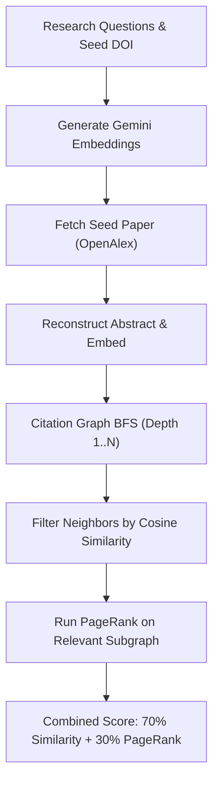

# GraphSelect — Advancing Research Papers Semantic Search with Embeddings & Knowledge Graphs

**GraphSelect** is a FastAPI-powered academic literature discovery and ranking engine that combines **Gemini semantic embeddings**, **citation-graph BFS traversal** (via OpenAlex & OpenCitations), and **PageRank centrality** to surface relevant research papers from a small seed set and research questions.

---

## How It Works



- **Semantic Filtering:** Evaluates cosine similarity between candidate abstracts and research questions ($\max_q \text{Sim}(\vec{a}, \vec{q}) \ge \text{threshold}$).
- **Graph Ranking:** Computes iterative PageRank over the discovered citation/reference subgraph and blends semantic relevance with network centrality.
- **Streaming Progress:** Supports Server-Sent Events (`/search/stream`) and includes an embedded Tailwind UI test bench (`code/static/index.html`).

---

## Tech Stack

- **Backend:** Python, FastAPI, Pydantic v2, `httpx` (async), `google-genai`
- **Data Sources:** OpenAlex API, OpenCitations API
- **Deployment:** Multi-stage non-root `Dockerfile`, `docker-compose.yml`, GitHub Actions CI & GHCR publish workflows

---

## Quick Start

### Using Docker (Recommended)
```bash
cd code
cp .env.example .env   # add your GEMINI_API_KEY
docker compose up --build
```

### Local Python Setup
```bash
cd code
pip install -r requirements.txt
uvicorn main:app --reload
```

### Run Tests
```bash
cd code
pytest
```

---

## Documentation

- [AI Developer Handbook & Architecture Guide](AI_README.md)
- [Contributing Guidelines](CONTRIBUTING.md)
- [Security Policy](SECURITY.md)
- [License (BSD 3-Clause)](LICENSE)
